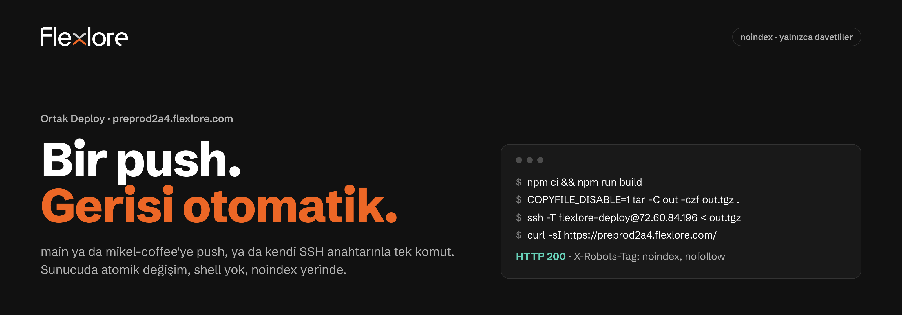
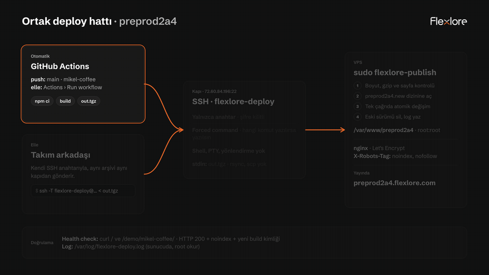
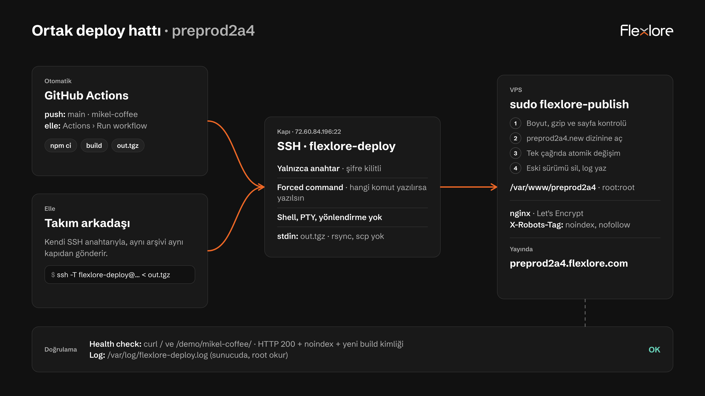
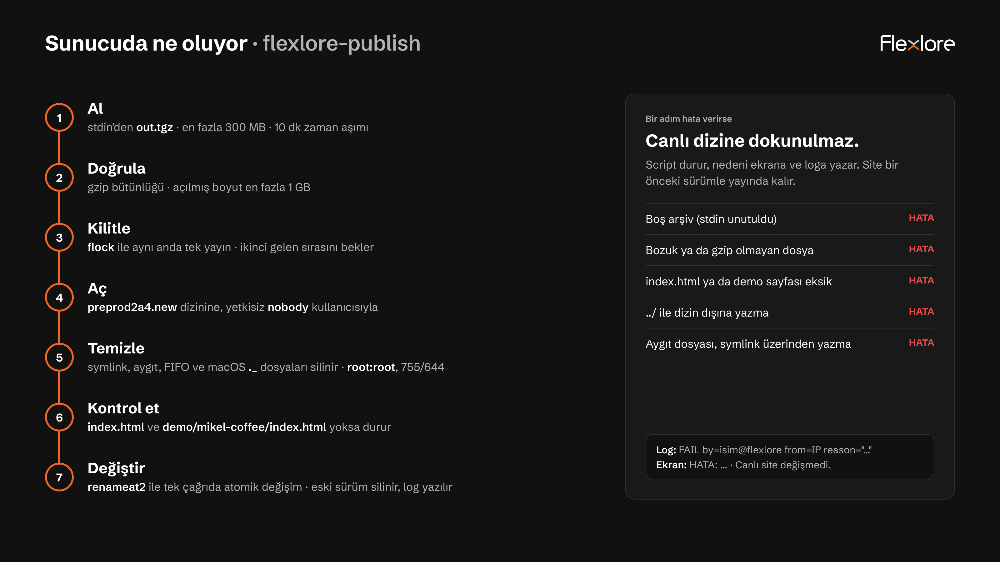
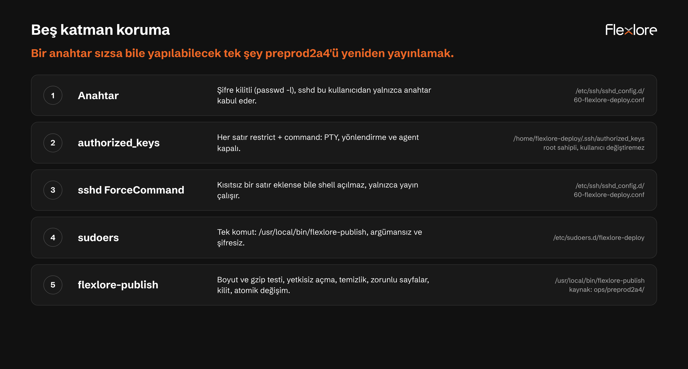

# Ortak Deploy · preprod2a4



`main` ya da `mikel-coffee`'ye push ettiğinde site kendiliğinden https://preprod2a4.flexlore.com/ adresinde güncellenir. Takım arkadaşları aynı işi kendi SSH anahtarlarıyla tek komutla da yapabilir. Site her zaman `noindex, nofollow` kalır.

- **Hedef:** yalnızca `/var/www/preprod2a4` (VPS `72.60.84.196`)
- **Kapı:** `flexlore-deploy` kullanıcısı. Yalnızca anahtarla girer, shell almaz, sadece yayın scriptini çalıştırır.
- **Süre:** 2 Kasım'daki ilk otomatik deploy, push'tan health check'e kadar 40 saniye sürdü.

## 15 saniyede akış



Video dosyası: [deploy-akisi.mp4](assets/ortak-deploy/deploy-akisi.mp4)

## Elle deploy (takım arkadaşı)

Repo kökünde, kendi anahtarınla:

```bash
npm ci && npm run build
COPYFILE_DISABLE=1 tar -C out -czf out.tgz .
ssh -T -i ~/.ssh/<kendi_anahtarın> flexlore-deploy@72.60.84.196 < out.tgz
```

Yayını kontrol et:

```bash
curl -sI https://preprod2a4.flexlore.com/demo/mikel-coffee/ | grep -iE "^HTTP|x-robots"
```

Beklenen: `HTTP/1.1 200 OK` ve `X-Robots-Tag: noindex, nofollow`.

| Ayrıntı | Neden |
| --- | --- |
| `COPYFILE_DISABLE=1` | macOS'taki `tar` her dosya için bir `._` artığı ekler (bu build'de 244 dosya). Linux'ta etkisizdir. |
| `-T` | "Pseudo-terminal will not be allocated" uyarısını kapatır. Hesap zaten terminal vermez. |
| stdin'den `out.tgz` | Tek yol budur. rsync ve scp bilerek desteklenmez. |
| Zaman aşımı | VPS'te port 22 bazen ilk denemede yanıt vermiyor. Komutu tekrar çalıştır. |

## Mimari



1. **Kaynak:** GitHub Actions (`main` ve `mikel-coffee` push'u ya da elle "Run workflow") veya takım arkadaşının makinesi.
2. **Build:** `npm ci && npm run build` ile Next.js statik export (`out/`), sonra `out.tgz`.
3. **Kapı:** `ssh flexlore-deploy@72.60.84.196 < out.tgz`. Anahtar zorunlu, forced command: yazılan komut yok sayılır.
4. **Sunucu:** `sudo /usr/local/bin/flexlore-publish` arşivi `preprod2a4.new`'e açar, kontrol eder, canlı dizinle atomik olarak değiştirir. Ek yedek tutulmaz.
5. **Yayın:** nginx ve Let's Encrypt aynen kalır. `X-Robots-Tag: noindex, nofollow` nginx'te tanımlı, deploy ona dokunmaz.
6. **Doğrulama:** Actions `/` ve `/demo/mikel-coffee/` için HTTP 200, noindex ve yeni build kimliğini kontrol eder.

## GitHub Actions

Dosya: [`.github/workflows/deploy-preprod.yml`](../.github/workflows/deploy-preprod.yml) · Workflow adı: **Deploy preprod2a4**

| Adım | Ne yapar |
| --- | --- |
| Tetik | `main` ve `mikel-coffee` push'u, elle `workflow_dispatch`. Aynı anda tek deploy çalışır (concurrency), sıradaki bekler. |
| Build | Node 24, `npm ci`, `npm run build` |
| Paket | `out/index.html` ve `out/demo/mikel-coffee/index.html` yoksa durur, varsa `out.tgz` |
| Deploy | Yalnızca bağlantı hatasında 5 kez tekrar dener (15, 30, 45, 60 sn arayla). Sunucu arşivi reddederse tekrar denemez. |
| Health check | `/` ve `/demo/mikel-coffee/`: HTTP 200, `X-Robots-Tag` içinde noindex, sayfada bu build'in kimliği. Sonuç run özetinde tablo olarak görünür. |
| Güvenlik testi | Elle çalıştırmada ya da commit mesajında `[guvenlik-testi]` varsa: CI anahtarıyla komut ve port yönlendirme dener, shell açılmadığını ve sitenin sağlam kaldığını doğrular. Boş arşiv göndermez. |

Elle çalıştırmak için: GitHub'da **Actions › Deploy preprod2a4 › Run workflow**.

### Secrets checklist

Settings › Secrets and variables › Actions altında:

| Secret | İçerik |
| --- | --- |
| `DEPLOY_HOST` | `72.60.84.196` |
| `DEPLOY_USER` | `flexlore-deploy` |
| `DEPLOY_KEY` | CI özel anahtarı (`flexlore-ci@github-actions`). Yalnızca bu secret'ta durmalı. |
| `DEPLOY_KNOWN_HOSTS` | VPS host anahtarları. SSH `StrictHostKeyChecking=yes` ile bağlanır. |

Özel anahtar ve host anahtarı log'a yazılmaz. Workflow anahtarı geçici bir dosyaya yazar ve iş bitince siler.

## Sunucuda ne oluyor



Bir adım hata verirse script durur, nedeni ekrana ve `/var/log/flexlore-deploy.log`'a yazar. Canlı site bir önceki sürümle yayında kalır.

## Güvenlik katmanları



> **Kurulum durumu (2 Kasım 2026):** Sunucuda şu an 2 Kasım 17:33'te kurulan ilk sürüm çalışıyor ve otomatik deploy onunla başarılı. Bu sürümün içeriği root erişimi olmadan incelenemedi. Yukarıdaki iki görseldeki davranış, [`ops/preprod2a4/`](../ops/preprod2a4/) altındaki gözden geçirilmiş sürüme aittir: arşiv yetkisiz kullanıcıyla açılır, boyut sınırı, demo sayfası kontrolü, macOS `._` temizliği, "kim yayınladı" logu ve sshd `ForceCommand` katmanı ekler. Docker'da Ubuntu 26.04 üzerinde test edildi, sunucuya henüz kurulmadı. Kurmak için aşağıdaki "Sunucu kurulumu" bölümü yeterli.

## Takım anahtarı ekleme ve kaldırma

Herkes kendi anahtarını kullanır. Özel anahtar (private key) asla paylaşılmaz, Slack'e ya da Notion'a yazılmaz.

1. Takım arkadaşı anahtar üretir ve yalnızca `.pub` dosyasını Ata'ya gönderir:

    ```bash
    ssh-keygen -t ed25519 -C "isim@flexlore" -f ~/.ssh/flexlore_deploy
    cat ~/.ssh/flexlore_deploy.pub
    ```

2. Ata (root) anahtarı kısıtlı satırla ekler:

    ```bash
    echo 'restrict,command="sudo /usr/local/bin/flexlore-publish" ssh-ed25519 AAAA... isim@flexlore' | ssh root@72.60.84.196 'cat >> /home/flexlore-deploy/.ssh/authorized_keys'
    ```

3. Takım arkadaşı ilk deploy'unu yapar (yukarıdaki "Elle deploy").
4. Kaldırmak için o satır silinir:

    ```bash
    ssh root@72.60.84.196 "sed -i '/ isim@flexlore\$/d' /home/flexlore-deploy/.ssh/authorized_keys"
    ```

Kayıtlı anahtarların listesi: `ssh root@72.60.84.196 "awk '{print \$NF}' /home/flexlore-deploy/.ssh/authorized_keys"`

## Kurallar

- Yayın hedefi yalnızca `/var/www/preprod2a4`. nginx, Let's Encrypt, diğer siteler, DNS ve Vercel'e dokunulmaz.
- `noindex, nofollow` kalkmaz. Health check her deploy'da kontrol eder.
- Sitede fiyat ve uydurma metrik yayınlanmaz.
- Root şifresi paylaşılmaz ve hiçbir dokümana yazılmaz.
- Demo sayfası (`/demo/mikel-coffee/`) olmayan build yayınlanmaz. CI paket adımında durur.

## Sorun giderme

| Belirti | Neden | Çözüm |
| --- | --- | --- |
| `Connection timed out` (port 22) | VPS bazen ilk denemede yanıt vermiyor | Tekrar dene. CI 5 kez kendisi dener. |
| `Permission denied (publickey)` | Anahtar ekli değil ya da yanlış `-i` | `.pub`'ı Ata'ya gönder, `-i` yolunu kontrol et |
| `PTY allocation request failed` | Hesaptan shell istendi | Normal. Bu hesap shell vermez. |
| Arşiv reddedildi, site değişmedi | Boş, bozuk ya da eksik arşiv (`< out.tgz` unutuldu, build yarım) | Build'i ve `tar` komutunu tekrarla |
| Health check: build kimliği yok | Canlıda hâlâ eski sürüm var | Deploy adımının çıktısına ve sunucu loguna bak |
| Health check: noindex yok | nginx ayarı değişmiş | Deploy'u durdur, nginx'i root ile kontrol et. Deploy noindex eklemez, kaldırmaz. |

## CI anahtarı sızarsa

1. Erişimi hemen kes: root ile `flexlore-ci@github-actions` satırını sil.

    ```bash
    ssh root@72.60.84.196 "sed -i '/ flexlore-ci@github-actions\$/d' /home/flexlore-deploy/.ssh/authorized_keys"
    ```

2. Yeni anahtarı kendi makinende üret (şifresiz, sadece CI için):

    ```bash
    ssh-keygen -t ed25519 -N "" -C "flexlore-ci@github-actions" -f ./flexlore-ci
    ```

3. `flexlore-ci.pub`'ı yukarıdaki kısıtlı satırla sunucuya ekle.
4. Özel anahtarı secret'a yaz ve yerel kopyaları sil:

    ```bash
    gh secret set DEPLOY_KEY --repo aatahannbayram/Flexlore-v2.0 < ./flexlore-ci
    rm -P ./flexlore-ci ./flexlore-ci.pub
    ```

5. **Actions › Deploy preprod2a4 › Run workflow** ile doğrula.
6. Sunucu logunda beklenmeyen saat ya da IP var mı bak: `ssh root@72.60.84.196 tail -50 /var/log/flexlore-deploy.log`
7. Şüpheli bir yayın varsa son iyi commit'ten yeniden deploy et.

Anahtar sızsa bile yapılabilecek tek şey `/var/www/preprod2a4`'ü yeniden yayınlamaktır. Shell, sudo ya da başka dizine yazma hakkı yoktur.

## Sunucu kurulumu ve güncelleme (root)

[`ops/preprod2a4/`](../ops/preprod2a4/) kullanıcıyı, scripti, sudoers'ı, sshd kuralını ve logrotate'i kurar. Tekrar tekrar çalıştırılabilir. Mevcut anahtarlara, nginx'e ve site içeriğine dokunmaz. root için etkin sshd ayarı değişecekse kendini geri alır.

```bash
tar -C ops/preprod2a4 -cz . | ssh root@72.60.84.196 'd=$(mktemp -d) && tar -xz -C "$d" && bash "$d/install.sh"; rc=$?; rm -rf "$d"; exit $rc'
```

| Dosya | Sunucudaki yeri |
| --- | --- |
| `flexlore-publish` | `/usr/local/bin/flexlore-publish` (root:root 755) |
| `sudoers.flexlore-deploy` | `/etc/sudoers.d/flexlore-deploy` (440, `visudo -c` ile doğrulanır) |
| `sshd.flexlore-deploy.conf` | `/etc/ssh/sshd_config.d/60-flexlore-deploy.conf` |
| `logrotate.flexlore-deploy` | `/etc/logrotate.d/flexlore-deploy` |

Görsellerin kaynağı [`assets/ortak-deploy/src/`](assets/ortak-deploy/src/) altında. Yeniden üretmek için: `node docs/assets/ortak-deploy/src/render.mjs` (Node 22+, Chrome, ffmpeg).
